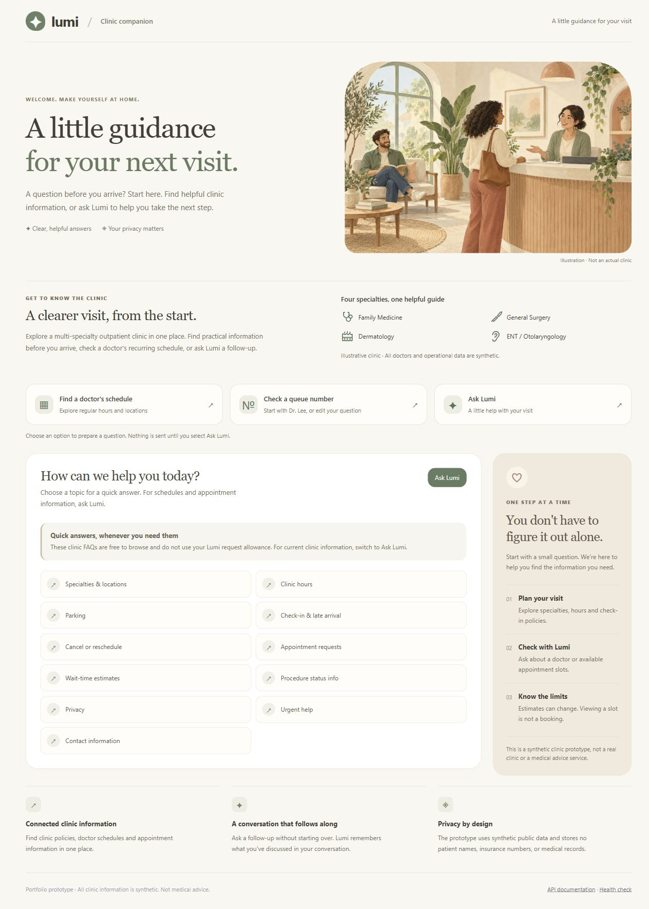
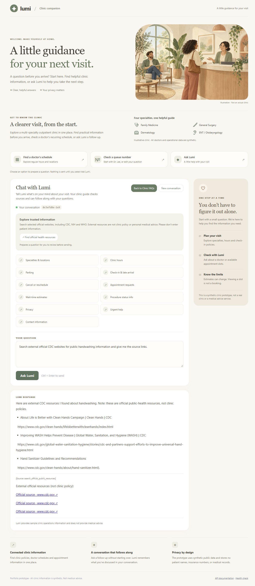
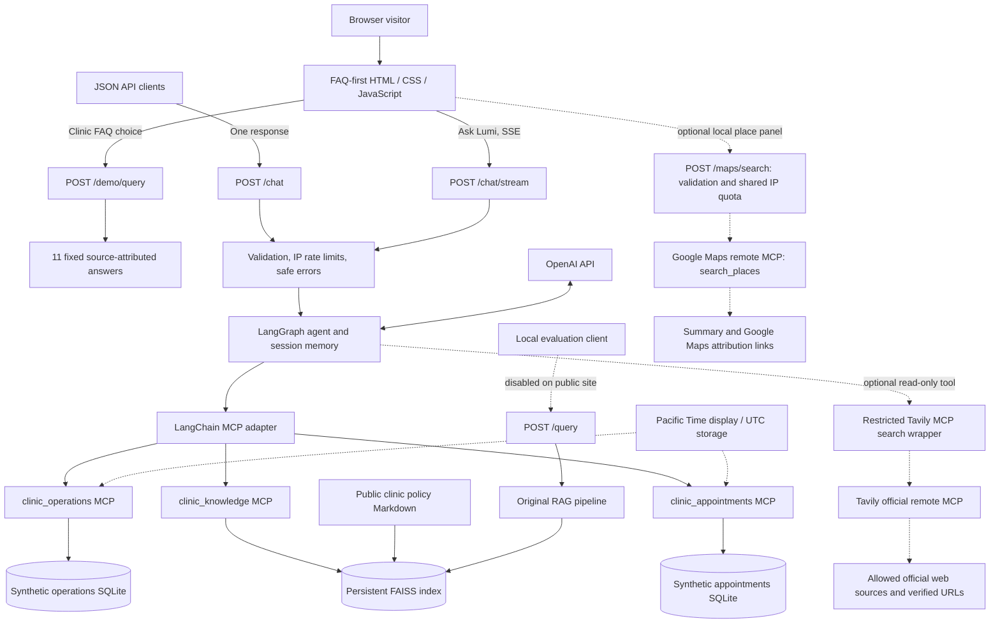

# 🏥 Intelligent Clinic Assistant

A portfolio-ready, synthetic multi-specialty outpatient operations and
knowledge assistant built with
**FastAPI, LangGraph, Model Context Protocol (MCP), OpenAI, FAISS, SQLite, and
JavaScript**.

🌐 **Live site:** [Lumi](https://lumi-939611494549.us-west1.run.app)

The `lumi` Cloud Run service was deployed on 2026-10-22 with the warm English
visitor interface, four synthetic specialties, and single-agent OpenAI routing.
The supervisor / multi-provider comparison remains a local experiment. Optional
Google Maps lookup is disabled in the public service. Tavily official-resource
search and its visitor-facing entry were deployed and live-tested on 2026-10-22.
The previous
`intelligent-clinic-assistant` service is retained separately and was not updated.

The browser opens in a **Clinic FAQ mode that does not call OpenAI**. Visitors
can optionally switch to **Lumi**, a virtual clinic guide that uses a LangGraph
agent to select from nine tools exposed by three MCP servers. Lumi can answer
source-grounded policy questions, read synthetic queue and procedure status,
check doctor schedules, and reserve anonymous synthetic appointment slots while
retaining context within the browser session.

> All doctors, queues, procedures, appointments, contact details, and
> timestamps in this project are synthetic. The application is not connected
> to a real clinic and does not provide medical advice.

---

## ✨ Highlights

- 📚 FAQ-first interface with eleven fixed, source-attributed clinic answers
- 🏥 Four synthetic specialties: Family Medicine, General Surgery,
  Dermatology, and Otolaryngology (ENT)
- 💡 Lumi virtual clinic guide with free-form, multi-turn conversation
- 🧠 LangGraph agent with session-scoped memory and multi-tool chaining
- 🧭 Opt-in LangGraph supervisor with three scoped, tool-using specialists
- ⚡ Persistent per-instance MCP connections and a reusable compiled agent graph
- 🔌 Three MCP servers exposing nine typed tools
- 🔎 OpenAI-powered semantic retrieval over a persistent FAISS index
- 🗄️ Synthetic queue, procedure, schedule, and appointment data in SQLite
- 🕒 Pacific Time presentation with UTC timestamp storage
- 📅 Anonymous appointment reservations without patient or insurance data
- 🛡️ Input validation, IP rate limiting, safe errors, and a public chat switch
- 📊 Original RAG pipeline and 30-query retrieval evaluation retained
- 🐳 Multi-stage, non-root Docker image
- ✅ 157 automated tests covering the API, MCP integration, retrieval, memory,
  validation, rate limits, failure handling, and container files

---

## 🖥️ Web Experience

### 🌿 Visitor interface

The English visitor interface uses warm cream and sage colors, responsive FAQ
tiles, a visitor guide, and safely rendered answer paragraphs and lists. Its
welcome illustration is AI-generated, not a photo of an actual clinic; all
clinic data remains synthetic.

A short clinic introduction and specialty-specific icons accompany three
shortcuts: doctor schedules, queue numbers, and Ask Lumi. Shortcuts prepare an
editable question; they do not send a request or consume model quota until the
visitor submits it. The queue shortcut starts with Dr. Lee and does not infer a
wait from ticket-number gaps.

### 🧭 Optional real-world place lookup (local, opt-in)

Google Maps Grounding Lite is an **optional external MCP integration**, separate
from the three clinic servers and Lumi's synthetic clinic conversation. The
visitor panel calls `search_places` over Streamable HTTP; it does not yet provide
route computation or automatically route Lumi questions to Maps. It displays
the returned summary with immediately adjacent Google Maps source links.

To enable it locally, add `GOOGLE_MAPS_ENABLED=true` and
`GOOGLE_MAPS_API_KEY=your_private_key` to the untracked `.env`, then restart the
server. Never put a real key in `.env.example` or `mcp_config.json`. Enable the
Maps Grounding Lite API for a regular key, or use a Maps Demo Key for prototyping.
See [Google's setup and attribution requirements](https://developers.google.com/maps/ai/grounding-lite).

The feature is disabled by default and hidden when unconfigured. Remote access
has **not yet been live-verified with a real key**. Queries must name real places
and cities; fictional Clinic A/B and Specialty Suite have no real Maps addresses.
Do not submit patient information. Google results are returned directly without
an additional LLM call, database writes, FAISS indexing, or session-memory storage.
Responses use `Cache-Control: no-store`, a 25-second timeout, controlled errors,
and the same IP-based minute/day quota and public-access switch as chat.

### 🌐 Tavily official-resource search

Lumi can use a restricted tool, `search_official_public_resources`, backed by
Tavily's official remote MCP at `https://mcp.tavily.com/mcp/`. This is an actual
external MCP tool call, not a locally simulated search or a Tavily REST call.
It is available to the single agent and directly to the experimental supervisor
manager; it does not create a fourth specialist agent.

Set `TAVILY_API_KEY` only in the untracked `.env`. A configured key opts in unless
`TAVILY_ENABLED=false`. The public deployment has this feature enabled, with
its key configured server-side only.
Restart the local server after changing configuration. Authentication uses a
server-side Authorization header, never a query-string key or browser credential.

Only `tavily_search` is invoked: one basic search per chat turn, at most three
results, a 25-second timeout, and a fixed official-domain allowlist (`cdc.gov`,
`nih.gov`, `medlineplus.gov`, `who.int`, `fda.gov`, `hhs.gov`). Result URLs are
checked again after retrieval. Extract, Crawl, Map, and Research are not exposed.
The existing chat endpoint quota still applies; Tavily credits and model usage
are billed by their respective providers. Disabled or failed search returns a
controlled unavailable result, not an invented web answer.

Use this only for explicitly requested, non-personal external public resources,
not clinic policies, doctor status, appointment facts, diagnosis, treatment, or
dosing. Prompt instructions mark retrieved snippets as untrusted content, and
the application appends only current-turn tool-returned source URLs. Snippets
can enter session memory and model input; do not submit patient information.
Simple input checks are not comprehensive PII detection or a prompt-injection
security guarantee.

On 2026-10-22, a direct remote MCP search returned three CDC URLs. A separate
end-to-end single-agent browser test then invoked the search tool and displayed
three verified, clickable CDC links; its server-reported turn time was 8.5 seconds
(one smoke test, not a latency benchmark). Supervisor tool availability has
automated coverage, but this new external path has not been live-tested in
supervisor mode. The public single-agent Cloud Run path was subsequently
verified with one real search returning three CDC source links.
Example question: **"Search external official CDC websites for public
handwashing information and give me the source links."**

In the browser, select **Ask Lumi**, then **Find official health resources**.
The panel appears only when external search is configured and public chat is
enabled. Its button prepares an editable question without sending it; select
**Ask Lumi** again to submit. The panel explains the official-source scope,
medical-advice boundary, and instruction not to enter patient information.

### 📚 Clinic FAQ mode



FAQ mode is the default landing page. It provides eleven predefined questions
covering sample specialties, clinic hours, parking, check-in and late arrival,
cancellations, appointment requests, wait-time estimates, procedure-status
labels, privacy, urgent help, and sample contact information.

FAQ answers are returned through `POST /demo/query`. They do not call OpenAI
and do not consume Lumi's request quota. Current queue, procedure, schedule,
and appointment availability are intentionally excluded from this mode.

### 💡 Ask Lumi



When `PUBLIC_CHAT_ENABLED=true`, the **Ask Lumi** button opens the free-form
agent interface. The browser sends questions to `POST /chat/stream` (SSE progress
followed by the complete answer); JSON API clients can use `POST /chat`. Lumi discovers the MCP tools,
selects the appropriate tool or tools, and cites the supporting policy document
or operational tool in the response.

The screenshot shows a real public-site Tavily answer and verified official
source links; it is not a booking confirmation. Lumi can also combine
synthetic procedure status with policy information when the relevant tools
return supporting evidence.

### 🧠 Dynamic status and session memory

For a follow-up that asks only to check again, Lumi retains the doctor and procedure
context under the same browser session ID, calls the tool again, and returns a
new remaining-time estimate. Public timestamps are displayed in Pacific Time.

---

## 🏗️ System Architecture



The clinic assistant has three main request paths, plus an optional Maps path:

1. 📚 `POST /demo/query` returns a selected fixed FAQ answer without using an LLM.
2. 💡 `POST /chat/stream` runs Lumi through the same LangGraph, OpenAI, and MCP
   layer, returning SSE progress and a final answer. `POST /chat` retains the
   single-response JSON contract. Both share the same per-IP request quota.
3. 🔎 `POST /query` preserves the original FAISS RAG pipeline for local
   evaluation and backward compatibility. It is disabled on the public Cloud
   Run service with `DEMO_MODE=true`.
4. 🧭 `POST /maps/search` calls the optional external Google Maps MCP directly,
   without an LLM, session-memory writes, or FAISS indexing. It shares the chat
   quota and is disabled in the public deployment. It is not one of Lumi's
   nine clinic tools. `GET /maps/status` reports configuration, not a successful
   live connection.

FastAPI initializes the three MCP connections and compiles the LangGraph agent
once during the application lifespan. Later Lumi turns reuse that warm runtime
instead of starting and rediscovering all three MCP servers for every request.
Agent turns are serialized within an instance so connected stdio MCP sessions
cannot mix request context.
For common doctor, queue, schedule, and appointment questions, the default
single-agent path first retrieves the requested MCP evidence using verified
doctor IDs. It then asks the model to explain those results; the model may
request additional tools when needed. This prevents an empty result for an
invented doctor ID from being treated as missing availability. Viewing an
appointment slot never books it.
For schedule-only questions, the final answer is rendered directly from the
verified doctor directory and schedule tool results. This prevents an agent
from inventing a same-day location or a nonexistent live portal. If a mixed
appointment answer omits slots already returned by the tool, the response
falls back to those verified slot details rather than denying availability.

### 🧭 Experimental three-agent supervisor

Set `CLINIC_AGENT_MODE=supervisor` **locally** to use a separate LangGraph
manager graph. It delegates to three independently compiled, model-driven
specialist graphs and combines their verified findings:

```text
Visitor → Lumi supervisor
          ├─ Policy/RAG agent → clinic_knowledge MCP
          ├─ Operations agent → clinic_operations MCP
          └─ Appointments agent → appointment availability MCP
                                  + shared doctor-directory tool
```

The manager has a deterministic minimum route for explicitly requested doctor,
schedule, appointment, and policy facts; it may consult additional specialists
when needed. A multi-source question may require several. Each specialist has
its own prompt and a limited
tool set. The appointments specialist is deliberately **read-only**: it cannot
call `book_appointment`, because a staff-approved booking/confirmation workflow
has not been added to this mode. Specialist outputs carry source IDs taken from
successful MCP tool calls; the manager's answer receives those verified
citations, not citations invented in model text. The manager also receives the
successful operations and appointment tool data so a specialist summary cannot
hide a listed slot or location. Specialist calls are
serialized against the persistent stdio MCP sessions. This is an opt-in local
architecture exercise, not the revision currently deployed at the live URL.

The supervisor is only one part of Assignment 2. A second LLM provider with
task-based routing is now available as a **local opt-in experiment**. With
`CLINIC_AGENT_MODE=supervisor` and `CLINIC_PROVIDER_ROUTING=domain`, the
policy/RAG specialist uses NVIDIA's NIM API; the supervisor,
operations specialist, and appointments specialist remain on OpenAI. This
deterministic domain route is not a measured cost, quality, or latency
optimization. Set `NVIDIA_API_KEY` and optionally `NVIDIA_MODEL` in your
untracked `.env`, then restart locally. No extra Python package is needed: the
NVIDIA-hosted endpoint supports the existing OpenAI-compatible chat client. Do
not put keys in Git or enable this on the public Cloud Run service without
checking NVIDIA's prototype-use terms and testing real tool calls. NVIDIA's
developer endpoint does not use the existing Google Cloud credit.
For short, source-grounded policy synthesis, `NVIDIA_ENABLE_THINKING=false`
disables the model's optional extended reasoning; set it to `true` to restore
that behavior. This is a latency/quality trade-off, not a guaranteed speedup.
For a first local check, ask **"What are your clinic hours?"** in supervisor
mode; this must route through the policy specialist. The cross-provider path
has automated tests and a small local live-call pilot using a NVIDIA API key.
It has **not** been validated across the full scenario set or deployed to Cloud Run.
Pinecone/Chroma, token-level streaming (if required), and measured
accuracy/dollar-cost results remain to be implemented and verified. The local
evaluation runner records provider-reported token usage and latency; see
[evaluation instructions](app/evaluation/README.md).

The 2026-10-07 local comparison covered five scenarios and six chat turns per
mode. Mean turn latency was 4.763 seconds for the single agent and 8.266 seconds
for the supervisor; the modes made 7 and 19 model calls respectively. Both
completed every request and passed the citation/phrase smoke checks. Answer
review found no clear supervisor quality advantage on these cases and identified
unsupported speculation in one single-agent unknown-doctor answer, subsequently
addressed with a verified-directory response guard. The comparison predates that
guard. These small, sequential runs change both architecture and provider routing;
they do not isolate an architectural benefit or measure dollar cost. The
recommended public-demo configuration remains `single` with `openai` routing,
while the supervisor remains an opt-in experiment. See the
[comparison notes](docs/agent-comparison-2026-10-07.md).

---

## 🔌 MCP Servers and Tools

The agent reads `mcp_config.json`, starts each local server with the active
Python interpreter, and discovers the tools through the MCP protocol.

| MCP server | Tool | Purpose |
|---|---|---|
| `clinic_operations` | `list_doctors` | List the synthetic doctors and their IDs |
| `clinic_operations` | `get_queue_status` | Return a doctor's synthetic current number, last issued number, and update time without inferring wait from ticket gaps |
| `clinic_operations` | `get_procedure_status` | Return procedure status, calculated remaining time, and the estimate disclaimer |
| `clinic_operations` | `get_doctor_schedule` | Return a recurring schedule, optionally filtered by weekday |
| `clinic_knowledge` | `list_knowledge_documents` | List the available public policy documents |
| `clinic_knowledge` | `search_clinic_knowledge` | Search policy passages using configured semantic FAISS or lexical retrieval |
| `clinic_knowledge` | `read_knowledge_document` | Read one complete policy document by ID |
| `clinic_appointments` | `list_available_appointments` | List synthetic slots by doctor and/or date |
| `clinic_appointments` | `book_appointment` | Reserve a slot and return an anonymous booking reference |

The system prompt requires clinic-specific claims to come from tool results.
The API appends citations from successful tools used in the current turn and
document IDs returned by knowledge tools. When the available data is
insufficient, Lumi is instructed to say so rather than invent a policy or
status.

Operational data is synthetic SQLite seed data. Dr. Lee initially serves ticket
18 and has issued tickets through 24. The queue tool does not convert number
gaps into people-ahead counts or wait estimates, because skipped numbers make
those calculations unreliable. A number above the last issued number, such as
28, is unissued in this snapshot; a lower number cannot be confirmed as an
individually issued or called ticket without a ticket-level record. Dr.
Chen's sample procedure is initially set to start 30 minutes before the
database is seeded and to end 45 minutes afterward. After that estimated end
passes, the next database read resets its sample start/end to 30 minutes before
and 45 minutes after that read.
Queue timestamps refresh on reads, but queue numbers do not automatically
advance. These timestamps and procedure estimates demonstrate changing data; they are
not connected to a real clinic or live staff updates.
For queue-only questions, both agent modes display a fixed answer built from
the successful queue tool result, rather than the model's arithmetic. Questions
combining a queue snapshot with missed-number policy also use a verified
section of `queue-and-wait-times.md`; without that document, the policy is
reported as unverified. In supervisor mode, this fixed public policy is read
directly by its known document ID rather than asking the policy specialist to
guess an ID. Other mixed questions still use the agent's synthesis
and require separate review.

Procedure follow-ups such as "check again" or "how many minutes remain" resolve
a single doctor only from successful procedure evidence in the immediately
preceding conversation turn. Both modes fetch a new status snapshot and render
the refreshed estimate from current-turn tool data. Missing or ambiguous context
is not guessed, and a failed refresh does not reuse the old remaining time.
Requests to extend a procedure or publish an update receive an explicit
capability refusal: this assistant has no staff update or publishing tools.

The expanded portfolio seed includes Dr. Rivera in Dermatology and Dr. Park in
Otolaryngology (ENT), alongside Dr. Lee in Family Medicine and Dr. Chen in
General Surgery. Each has a separate sample queue, recurring schedule, and
anonymous appointment slots. Newly generated slots use a weekday present in
the corresponding sample schedule. Availability excludes slots whose start
time has passed, using the configured clinic timezone; direct booking by slot
ID also rejects expired slots. Existing stored slots are not automatically
rescheduled, so a doctor may have no future slots in an older sample database.
For supported appointment/location questions, both agent modes render an empty
successful availability lookup separately from the doctor directory: a listed
doctor does not imply an available appointment. Failed or prior-turn lookups
are not treated as evidence of empty availability.
Existing two-doctor demo databases gain the
additional synthetic doctors and slots without replacing prior queue numbers or
reservations. The assistant can combine the doctor directory, schedule,
appointment availability, and clinic policy for multi-specialty questions;
this is still **one agent** using tools, not the Assignment 2 multi-agent design.

---

## 🔎 Knowledge and Retrieval

Public clinic policies are stored as Markdown files in `clinic_knowledge/`:

- 📅 Appointments and check-in
- 🏥 Specialties and locations
- 🕘 Clinic hours
- ☎️ Contact information
- 🅿️ Directions and parking
- 🏥 Procedure status
- ⏳ Queues and wait times
- 🚨 Urgent care and emergencies

`search_clinic_knowledge` splits these files into paragraphs, creates OpenAI
embeddings, normalizes the vectors, and stores them in a persistent FAISS
inner-product index. A content-and-model fingerprint is stored beside the
index, so it is reused while current and rebuilt when the source documents or
embedding model change.

Set `CLINIC_KNOWLEDGE_SEARCH_MODE=lexical` to use the key-free lexical search
implementation instead of semantic embeddings.

### 🧬 Original RAG pipeline

The original pipeline under `app/rag/` remains part of the project:

```text
Document loading → paragraph chunking → OpenAI embeddings → FAISS
→ Top-K retrieval → similarity filtering → LLM relevance validation
→ grounded answer with source metadata
```

The included 30-question benchmark contains 10 direct, 10 paraphrased, and 10
unanswerable questions. The recorded evaluation after switching from coarse to
paragraph-level chunks was:

| Metric | Recorded result |
|---|---:|
| Direct Recall@2 | 100% (10/10) |
| Paraphrased Recall@2 | 100% (10/10) |
| Unsupported-query rejection with similarity only | 20% (2/10) |
| Unsupported-query rejection with LLM validation | 90% (9/10) |
| Average retrieval and validation latency | 3.53 seconds |

These benchmark figures describe the original RAG evaluation dataset, not the
fixed FAQ endpoint or the synthetic MCP operations data.

An opt-in end-to-end scenario set now tests the agent's source citations,
multi-turn context, operational uncertainty, and safety boundaries. See
[the evaluation instructions](app/evaluation/README.md) and
[the Assignment 2 gap analysis](docs/assignment2-gap-analysis.md). Its
automated checks are not clinical accuracy scores.

---

## 🌐 API

Interactive OpenAPI documentation is available locally at
`http://127.0.0.1:8080/docs` after the application starts.

| Method and path | Purpose |
|---|---|
| `GET /` | Serve the browser interface |
| `GET /health` | Report service, agent, MCP-server count, and public-chat status |
| `GET /capabilities` | Report whether the official-resource entry is configured and permitted; no credentials or live-connectivity claim |
| `POST /demo/query` | Return one predefined Clinic FAQ answer |
| `POST /chat` | Run one session-scoped Lumi turn |
| `POST /chat/stream` | Stream a progress event, then a final Lumi answer or controlled error as SSE |
| `POST /query` | Run the original FAISS RAG pipeline when `DEMO_MODE=false`; disabled on the public site |
| `GET /maps/status` | Report whether the optional Maps panel is configured and permitted |
| `POST /maps/search` | Optional direct remote MCP place lookup with attribution; disabled publicly |

Example Lumi request:

```json
{
  "query": "What is Dr. Chen's current procedure status?",
  "session_id": "browser-generated-session-id"
}
```

Example response:

```json
{
  "response": "...source-grounded Lumi response..."
}
```

The browser uses `/chat/stream` with the same JSON request body. Its
`text/event-stream` response emits `progress`, then `answer` and `done` events,
or a controlled `error` event after streaming has begun. This is progress
streaming, **not token-by-token model output**. Pre-stream validation and quota
failures still return regular HTTP 4xx responses.

---

## 🛡️ Safety, Privacy, and Cost Controls

- ✍️ Chat questions are stripped and limited to 1,000 characters.
- 🪪 Session IDs are stripped and limited to 128 characters.
- 🚦 Each client IP is limited to 3 combined `/chat`, `/chat/stream`, and enabled `/maps/search` requests per minute and 10 per UTC
  day by default.
- ⏱️ Rate-limit responses use HTTP 429 with `Retry-After` and
  `X-Rate-Limit-Reason` headers.
- ↩️ When a limit is reached, the UI offers a user-controlled return to the
  Clinic FAQ mode, which uses no OpenAI API calls; it does not silently replace
  an agent answer.
- 🔒 `PUBLIC_CHAT_ENABLED=false` disables both chat endpoints with HTTP 403 and hides the
  **Ask Lumi** control without rebuilding the application.
- 🧯 Expected model, configuration, and MCP failures return controlled 502/503
  JSON responses, or a safe SSE `error` event after a stream starts, without exposing internal exception details.
- ⚠️ Unexpected errors return a generic HTTP 500 response.
- 🕶️ The synthetic dataset contains no patient records, and the application has
  no patient-record integration or patient-identification form. Free-form chat
  text is sent to the model provider and kept in session memory; do not enter
  names, diagnoses, record numbers, insurance details, or other sensitive data.
- 💳 Monitor provider usage and billing independently; application rate limits
  and budget alerts are not a guaranteed hard spending cap.

The rate limiter and LangGraph memory are intentionally in-process for this
single-instance portfolio application. Their state resets on restart and is
not shared across multiple workers. A production deployment should use a
shared store such as Redis or an API gateway.

---

## 🕒 Time and Synthetic Data

- 🌎 `America/Los_Angeles` is the default clinic timezone.
- 🌤️ Public timestamps and appointments automatically follow PST/PDT transitions.
- 🕒 Operational timestamp values are stored in UTC and converted at the MCP
  boundary.
- 🔄 Queue and procedure records are synthetic. With
  `CLINIC_REFRESH_DEMO_DATA=true`, expired demo timestamps are refreshed so the
  current-status examples remain useful.
- 📆 Appointment reservations are synthetic and anonymous. Booking consumes the
  selected demo slot and returns a generated reference such as `APT-XXXXXXXX`.

---

## 🧰 Technology Stack

- 🐍 **Backend:** Python, FastAPI, Pydantic, Uvicorn
- 🧠 **Agent:** LangGraph, LangChain MCP adapter, OpenAI API
- 🔎 **Retrieval:** OpenAI embeddings, FAISS, NumPy
- 🔌 **Protocol:** Model Context Protocol (MCP)
- 🗄️ **Storage:** SQLite, Markdown policy documents, persistent FAISS indexes
- 🎨 **Frontend:** HTML, CSS, JavaScript
- ✅ **Testing:** Pytest, FastAPI TestClient
- 🐳 **Deployment:** Docker, Linux-compatible non-root runtime

---

## 📁 Project Structure

```text
intelligent-clinic-platform/
├── app/
│   ├── api.py                       # FastAPI routes and fixed FAQ data
│   ├── models.py                    # Validated chat request/response models
│   ├── clinic_content.py            # Shared synthetic clinic seed loader
│   ├── rate_limit.py                # In-memory IP rate limiter
│   ├── services/
│   │   ├── chat.py                  # Single/supervisor graphs, providers, MCP, memory
│   │   ├── maps.py                  # Optional direct Google Maps MCP lookup
│   │   └── tavily.py                # Restricted official remote MCP search for Lumi
│   ├── rag/                         # Original RAG pipeline
│   │   ├── chunker.py
│   │   ├── embeddings.py
│   │   ├── loader.py
│   │   ├── rag.py
│   │   ├── relevance.py
│   │   ├── retriever.py
│   │   └── vector_store.py
│   └── evaluation/
│       ├── questions.json
│       ├── evaluate_rag.py
│       ├── evaluate_retrieval.py
│       ├── clinic_agent_eval.py
│       ├── clinic_agent_scenarios.json
│       ├── run_local_comparison.py
│       ├── compare_agent_reports.py
│       └── README.md
├── mcp_servers/
│   ├── clinic_operations/
│   │   ├── database.py
│   │   └── server.py
│   ├── clinic_knowledge/
│   │   └── server.py
│   ├── clinic_appointments/
│   │   ├── database.py
│   │   └── server.py
│   └── clinic_time.py
├── clinic_knowledge/                # Eight public policy documents
├── clinic_content/                  # Synthetic seed JSON and content notes
├── data/
│   └── clinic_faq.txt               # Original RAG evaluation corpus
├── static/
│   ├── index.html
│   ├── style.css
│   ├── app.js
│   ├── favicon.svg
│   └── images/                      # Generated welcome illustration and provenance
├── docs/                            # Architecture comparisons and resume notes
├── tests/                           # API, MCP, retrieval, and regression tests
├── images/                          # README screenshots
├── .dockerignore
├── .env.example
├── .gcloudignore                    # Exclude credentials and local data from source uploads
├── .gitignore
├── Dockerfile
├── main.py                          # Port 8080 application entry point
├── mcp_config.json                  # Three local MCP server definitions
├── requirements.txt
└── README.md
```

Generated SQLite databases, FAISS indexes, credentials, virtual environments,
and local cache files are excluded from version control.

---

## 🚀 Local Setup

### 🐍 1. Create and activate the environment

From Anaconda Prompt on Windows:

```cmd
conda create -p ./env python=3.12
conda activate ./env
```

### 📦 2. Install dependencies

```cmd
python -m pip install -r requirements.txt
```

### 🔑 3. Configure the application

Copy `.env.example` to `.env`, then set at least:

```text
OPENAI_API_KEY=your_key_here
OPENAI_MODEL=gpt-5-nano
OPENAI_REASONING_EFFORT=minimal
OPENAI_EMBEDDING_MODEL=text-embedding-3-small
```

Never commit `.env` or an API key.

### ▶️ 4. Start the application

```cmd
python main.py
```

Open:

- 🌐 Application: `http://127.0.0.1:8080`
- 📘 API documentation: `http://127.0.0.1:8080/docs`
- 💚 Health check: `http://127.0.0.1:8080/health`

The terminal displays `http://0.0.0.0:8080` because the server listens on all
local interfaces. `0.0.0.0` is a bind address; use `127.0.0.1` or `localhost`
in the browser.

`APP_RELOAD=true` is the local default. Set it to `false` when automatic reload
is not wanted.

---

## ⚙️ Configuration

| Variable | Default | Purpose |
|---|---|---|
| `OPENAI_API_KEY` | none | Required for Lumi and semantic embedding calls |
| `OPENAI_MODEL` | `gpt-5-nano` | Lumi chat model |
| `OPENAI_REASONING_EFFORT` | `minimal` | Reduce reasoning-token cost and latency for focused tool calls |
| `OPENAI_EMBEDDING_MODEL` | `text-embedding-3-small` | Semantic index model |
| `OPENAI_BASE_URL` | empty | Optional compatible API base URL |
| `CLINIC_AGENT_MODE` | `single` | `single` for current Lumi or `supervisor` for the opt-in three-specialist graph; restart after changing |
| `CLINIC_PROVIDER_ROUTING` | `openai` | `openai` keeps all agents on OpenAI; `domain` requires supervisor mode and routes only the policy/RAG specialist to NVIDIA NIM |
| `NVIDIA_API_KEY` | none | Required only for opt-in `domain` routing; use an untracked local `.env` |
| `NVIDIA_MODEL` | `nvidia/nemotron-3.5-lightning-30b-a3b` | NVIDIA model for the policy/RAG specialist in `domain` routing |
| `NVIDIA_ENABLE_THINKING` | `false` | Disable extended NVIDIA reasoning for faster policy synthesis; `true` restores it |
| `GOOGLE_MAPS_ENABLED` | `false` | Opt in to the independent Maps panel locally; disabled on Cloud Run |
| `GOOGLE_MAPS_API_KEY` | none | Server-side Maps credential; real remote responses are not yet verified |
| `TAVILY_API_KEY` | none | Private server-side credential for the official remote Tavily MCP |
| `TAVILY_ENABLED` | `true` when a key is present | Set `false` to disable external search; no key means disabled |
| `PUBLIC_CHAT_ENABLED` | `true` | Show and enable Lumi chat |
| `CHAT_RATE_LIMIT_PER_MINUTE` | `3` | Per-IP rolling-minute chat limit |
| `CHAT_RATE_LIMIT_PER_DAY` | `10` | Per-IP UTC-day chat limit |
| `MCP_SERVERS_CONFIG` | `mcp_config.json` | MCP server configuration path |
| `CLINIC_DB_PATH` | `data/clinic_operations.db` | Operations SQLite path |
| `CLINIC_REFRESH_DEMO_DATA` | `true` | Refresh expired synthetic procedure times |
| `CLINIC_TIMEZONE` | `America/Los_Angeles` | Public clinic timezone |
| `CLINIC_APPOINTMENTS_DB_PATH` | `data/clinic_appointments.db` | Appointment SQLite path |
| `CLINIC_KNOWLEDGE_DIR` | `clinic_knowledge` | Policy document directory |
| `CLINIC_KNOWLEDGE_INDEX_DIR` | `data` | Persistent knowledge-index directory |
| `CLINIC_KNOWLEDGE_SEARCH_MODE` | `semantic` | `semantic` or key-free `lexical` search |
| `DEMO_MODE` | `false` locally | Set to `true` on the public site to disable only the legacy `/query` endpoint |
| `APP_RELOAD` | `true` locally | Enable Uvicorn reload in `main.py` |
| `PORT` | `8080` | HTTP port |

### 🔒 FAQ-only mode

To expose only the fixed FAQ interface without Lumi/OpenAI chat:

```cmd
set PUBLIC_CHAT_ENABLED=false
python main.py
```

`POST /demo/query` remains available and `POST /chat` returns HTTP 403.

---

## 🐳 Docker

Build the image:

```bash
docker build -t intelligent-clinic-assistant .
```

Run it with environment configuration:

```bash
docker run --rm -p 8080:8080 --env-file .env intelligent-clinic-assistant
```

The Dockerfile uses separate builder and runtime stages, runs as a non-root
user, disables application reload, and exposes port 8080.

### ☁️ Cloud Run deployment settings

The current public service is `lumi` in project `intelligent-clinic-platform`,
region `us-west1`. It uses single-agent OpenAI routing, 1 GiB memory,
concurrency 1, minimum instances 0, and maximum instances 1. The legacy
`intelligent-clinic-assistant` service remains separate. Local edits and Git
pushes do not automatically deploy either service.

For a **new initial service**, start FAQ-only without a key in the command.
The quoted environment-variable argument also works in PowerShell:

```cmd
gcloud run deploy lumi --source . --project intelligent-clinic-platform --region us-west1 --allow-unauthenticated --min-instances 0 --max-instances 1 --concurrency 1 --memory 1Gi --set-env-vars "PUBLIC_CHAT_ENABLED=false,DEMO_MODE=true,CHAT_RATE_LIMIT_PER_MINUTE=3,CHAT_RATE_LIMIT_PER_DAY=10,APP_RELOAD=false,CLINIC_AGENT_MODE=single,CLINIC_PROVIDER_ROUTING=openai,GOOGLE_MAPS_ENABLED=false"
```

To enable Lumi after the initial deployment, open the service in the Cloud Run
console. Under **Containers → Variables & Secrets**, add the server-side
`OPENAI_API_KEY` environment variable and change `PUBLIC_CHAT_ENABLED` to
`true`, while keeping `DEMO_MODE=true`, then deploy a new revision. The public
`/query` endpoint then returns HTTP 403; the FAQ and Lumi remain available.
Keep the key out of command lines, Git, browser-side code, and screenshots.
Secret Manager is recommended for stronger secret handling, but is not required
for this portfolio deployment. The command above is for the initial FAQ-only
deployment; running it again would turn Lumi off and replace the service's
existing environment variables. Do not use that initial-creation command to
update the already configured `lumi` service.

For **subsequent updates of the configured service**, preserve its existing
server-side key with `--update-env-vars`:

```cmd
gcloud run deploy lumi --source . --project intelligent-clinic-platform --region us-west1 --allow-unauthenticated --min-instances 0 --max-instances 1 --concurrency 1 --memory 1Gi --update-env-vars "PUBLIC_CHAT_ENABLED=true,DEMO_MODE=true,CHAT_RATE_LIMIT_PER_MINUTE=3,CHAT_RATE_LIMIT_PER_DAY=10,APP_RELOAD=false,CLINIC_AGENT_MODE=single,CLINIC_PROVIDER_ROUTING=openai,GOOGLE_MAPS_ENABLED=false,OPENAI_MODEL=gpt-5-nano,OPENAI_REASONING_EFFORT=minimal"
```

Inspect source-upload exclusions with `gcloud meta list-files-for-upload`
before deploying. `.env.example` is a placeholder; `.env`, virtual environments,
runtime databases, and evaluation outputs must not be uploaded.

The 2026-10-22 deployment smoke check verified the new interface and illustration,
FAQ responses, one real Lumi queue response, disabled Maps, and HTTP 403 for
`POST /query`. The service settings were read back to confirm the configured
limits; this is not a load test or proof of a hard billing cap.

Cloud Run's local filesystem is ephemeral: generated SQLite data and FAISS
indexes are recreated after an instance stops. This is suitable for the
synthetic portfolio demo, but reservations and conversation history do not
persist across restarts.

---

## ✅ Tests

Run the full suite from the activated environment. Restrict collection to
`tests/` so local temporary folders are not scanned, and disable pytest's
optional cache if the workspace does not permit writing `.pytest_cache`:

```cmd
python -m pytest tests -q -p no:cacheprovider --basetemp=.pytest-tmp-local
```

`--basetemp` keeps test-created temporary data inside the project.

Verified on 2026-10-22 after adding Tavily, using a fresh local temporary
directory. Remote services are mocked in the automated suite; real Tavily
smoke checks are described separately above. Google Maps remains unverified:

```text
157 passed, 1 warning
```

This complete run includes the Tavily regressions, capability visibility,
credential redaction, and review-before-send UI contract. The only warning is
the existing LangChain MCP beta warning.

The suite tests:

- 🌐 FastAPI routes and frontend contracts
- ✍️ Request and session validation
- 📚 FAQ-only and public-chat behavior
- 🚦 Per-minute and daily rate limits
- 🧯 Safe model, MCP, and unexpected-error responses
- 🔌 MCP discovery and multi-tool agent execution
- 🧠 Session memory and session isolation
- 🧩 All three MCP servers and their typed schemas
- 🔎 Semantic FAISS retrieval and document attribution
- 🕒 Synthetic data refresh and Pacific Time conversion
- 🐳 Docker and `.dockerignore` safety requirements

The LangChain MCP adapter currently emits a beta API warning during tests; this
does not cause a test failure.

---

## 📊 Evaluation Commands

The original RAG evaluation requires an OpenAI API key and a built vector
store:

```cmd
python -m app.rag.vector_store
python -m app.evaluation.evaluate_retrieval
python -m app.evaluation.evaluate_rag
```

For the separate, opt-in chat scenario runner, see
[clinic agent evaluation](app/evaluation/README.md). It does not run as part of
the regular test suite because real chat requests consume model API quota.

---

## 🏥 Current Scope and Production Considerations

This repository is a working portfolio prototype, not a production medical
system. A production deployment would additionally require:

- 🔐 Authenticated clinic integrations instead of synthetic SQLite data
- 🧾 Authorization and audit logging
- 🔒 Encrypted persistent storage and formal data-retention rules
- 🌐 A distributed rate limiter and shared conversation store
- 📅 Appointment cancellation and identity-verification workflows
- 📈 Monitoring, alerting, and model/tool quality evaluation
- ⚖️ Clinical, privacy, legal, and security review

---

## 👤 Author

**Belle Dai**  
M.S. Computer Science, University of Southern California

Built as an independent project exploring practical **LLM agents, RAG,
LangGraph, MCP, retrieval evaluation, API safety, and AI application
engineering**.
